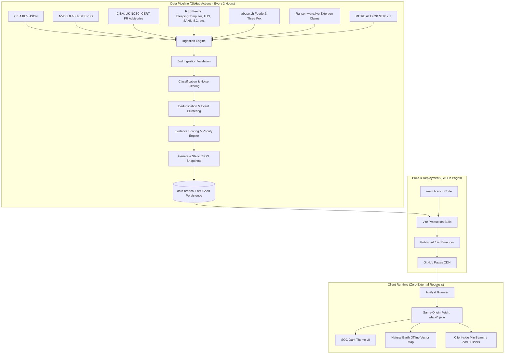

# Platform Architecture & Engineering Decisions

**Author:** Sulaiman Alhabsi  
**Audience:** SOC Engineering & Threat Intelligence Evaluation  
**Base URL:** `/Cyber-Threat-Intelligence-Platform/`

---

## 1. High-Level System Architecture

---

## 2. Core Architectural Decisions

### 2.1. Server-Side Pipeline vs. Public CORS Proxies
- **Decision:** Eliminate all client-side CORS proxies (`corsproxy.io`). Fetch, validate, and process all threat feeds server-side in a scheduled GitHub Actions workflow (`data-refresh.yml`).
- **Rationale:** 
  1. Guarantees 100% data availability even when third-party proxies go down.
  2. Eliminates MITM attack surface and exposure of client IP addresses.
  3. Enables heavy computation (clustering, STIX parsing, NLP entity extraction) without burdening client laptops.
  4. Keeps the frontend static and compliant with GitHub Pages hosting requirements.

### 2.2. Dual GitHub Actions Workflow Strategy
- **Decision:** Decouple data refresh from code deployment into two isolated workflows:
  1. `data-refresh.yml`: Runs on a 2-hour cron schedule (plus manual trigger). Restores previous snapshots from the `data` branch, runs `scripts/pipeline.ts`, executes **Zod schema validation only** (not full test suite), and commits new snapshots to the `data` branch only if schemas pass. If an individual feed fails, its last-good records are preserved and marked stale.
  2. `build-deploy.yml`: Triggers on push to `main` (code changes) and upon completion of `data-refresh.yml`. For code pushes, it enforces all quality gates: `npm ci`, `npm run lint`, `npm run type-check`, `npm test` (full Vitest suite), and `npm run build`. For scheduled data refreshes, it packages the tested code with the latest validated data snapshots and deploys to GitHub Pages.

### 2.3. Evidence-Based Data Status & Attribution
- **Decision:** Data-status labels are assigned **per record based on actual evidence**, never simply copied from the source's overall tier.
  - `Confirmed`: Supported by official advisories (CISA KEV, CERT bulletin) or an official statement from the affected organization.
  - `Vendor-assessed`: Documented by named security research teams (e.g. Mandiant, CrowdStrike, SentinelOne).
  - `Reported`: Sourced from independent technology news or community reporting without formal vendor whitepaper or advisory.
  - `Claimed`: Attacker self-statements or extortion leak-site postings (e.g. Ransomware.live).
  - `Inferred`: Derived by the dashboard's internal rules (e.g. industry sector inferred from organization name, geographic region inferred from gazetteer).
  - `Simulated`: Explicit demo data in an isolated folder, disabled by default.
- **Attribution Guardrail:** A keyword occurrence of a threat actor's name (e.g., "LockBit", "Lazarus") in a news article is labeled strictly as *"Mentioned in text"* and NEVER assigned as an attribution.

### 2.4. Event Clustering (Deduplication) Algorithm
- **Decision:** Prevent duplicate reporting across multiple RSS outlets by clustering incidents into unified `EventCluster` entities.
- **Algorithm:**
  1. Match on shared CVE identifiers (`cveID`).
  2. Match on normalized victim organization names within a 7-day rolling window.
  3. Match on title token Jaccard similarity (> 0.55) after removing stop words and news boilerplate.
  4. Designate the most authoritative or earliest source as the `primaryReport`, grouping subsequent articles as `supportingReports`.

### 2.5. Centralized Transparent Priority Scoring
- **Decision:** Priority scores (0–100) are computed dynamically using weights defined in a single source of truth configuration file (`src/config/scoring-weights.ts`).
- **Formula:**
  $$\text{Score} = \min(100, W_{\text{kev}} \cdot I_{\text{kev}} + W_{\text{ransom}} \cdot I_{\text{ransom}} + W_{\text{epss}} \cdot S_{\text{epss}} + W_{\text{cvss}} \cdot \frac{S_{\text{cvss}}}{10} + W_{\text{evid}} \cdot E + W_{\text{corr}} \cdot C - D_{\text{age}})$$
- **Factor Transparency:** Every incident view displays a granular breakdown chip showing exact point contributions. Labeled strictly as *"Dashboard Priority Score (Calculated). Not a CVSS score."*

### 2.6. 100% Offline Vector Map
- **Decision:** Render the Global Threat Map using a bundled Natural Earth 110m GeoJSON file (`public/data/world-110m.json`) via an offline SVG/Canvas projection.
- **Requirement:** Zero tile requests over the network in default mode. Unlocated incidents are counted and reported explicitly rather than guessed.
